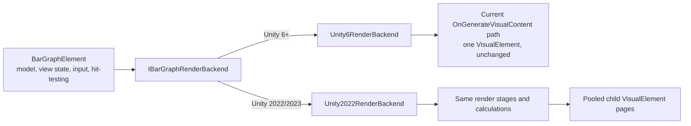

# Unity 2022 Rendering Change — One-Page Summary

## The change in one sentence

Put an explicit rendering-backend abstraction between `BarGraphElement` and UI Toolkit: Unity 6 uses a backend containing the current single-element renderer unchanged, while Unity 2022 uses a separate backend that delivers the same rendering stages through multiple pooled `VisualElement`s.

## Before and after



The compile-time version decision occurs once in a backend factory. Version checks do not enter chart data, interaction, sorting, or rendering calculations.

The Unity 2022 pages are an implementation detail of `Unity2022RenderBackend`. They do not own bars, segments, sorting, selection, or hit-testing.

## Backend contract

```csharp
private interface IBarGraphRenderBackend
{
    void Attach();
    void Invalidate();
    void Detach();
}
```

The contract does not expose chart data operations, selection APIs, or Unity-version conditionals to `BarGraphElement`.

`BarGraphRenderBackendFactory.Create(BarGraphElement owner)` is the only version switch:

```csharp
#if UNITY_6000_0_OR_NEWER
return new Unity6RenderBackend(owner);
#else
return new Unity2022RenderBackend(owner);
#endif
```

This is the extension point. A future Unity rendering change adds or replaces a backend instead of modifying chart behavior.

## Production code changed

| Change | Purpose |
|---|---|
| Add `IBarGraphRenderBackend` and a backend factory | Isolate Unity-version rendering behavior at one boundary |
| Add `Unity6RenderBackend` | Own the existing single-element callback without changing its rendering behavior |
| Add `Unity2022RenderBackend` | Own the Unity 2022 child-element composition and repaint lifecycle |
| Add a pooled mesh-page element used only by the 2022 backend | Write a contiguous range of the existing `QuadData[]` sequence into one legal mesh allocation |
| Extract the existing mesh-writing loop so it can write a range | Reuse the current vertex order, indices, UVs, tint, and texture without recalculating chart data |
| Route internal repaint/lifecycle handling through the selected backend | Keep Unity 2022 pages synchronized while Unity 6 retains its current repaint path |
| Add Unity-version compile and runtime fixtures | Exercise the page boundary and repaint bridge on Unity 2022 while preserving Unity 6 compilation |

Expected production scope is `Editor/BarChart/Core/BarGraphElement`, the new private backend files, and tests. Application controllers, input handlers, and model/view classes are outside the intended diff.

## What is specifically not changing

- `ChartDataModel` or the meaning of bars and segments
- `ChartViewState`, `DisplayToData`, or `DataToDisplay`
- `DrawDirectBars()` and `DrawLodBars()` calculations or LOD thresholds
- `HitTestBar()` or `HitTestSegment()`
- input handlers or `BarGraphEventBus`
- `PerFrameGraphController`
- `ProfilerSelectionHandler`
- marker/frame selection behavior
- colors, segment sizes, outlines, or sorting behavior

If any of those require a compatibility change, this design has failed and must return to review.

## Risk map in the existing code

| Risk | Existing code involved | What could break | Required guard |
|---|---|---|---|
| **Root repaint does not automatically refresh cached child geometry** | Calls to `MarkDirtyRepaint()` throughout `BarGraphElement`, its partials, and `PerFrameGraphController` | Bars or highlights can lag behind sorting, resize, hover, or selection | Prove and centralize root-to-page invalidation without changing the public refresh contract |
| **Paint order is behavior** | `OnGenerateVisualContent()` and `DrawHighlights()` | Selection, focus, hover, tag outlines, padding masks, axes, or callbacks can appear above/below the wrong content | Preserve the current stage order exactly; compare screenshots with overlapping states |
| **Sorting and interaction use different index spaces** | `EnsureSortMap()`, `DisplayToData`, `DataToDisplay`, hit tests, controller callbacks | Clicking a visible 256 KB segment can select a different frame or marker, especially in Order by Size | Pages consume the already ordered geometry only; event tuples and downstream profiler results must match the baseline |
| **Rendering and hit-testing duplicate coordinate math** | `DrawDirectBars()`, `SnapBarX()`, `HitTestBar()`, `HitTestSegment()` | A visual bar can disagree with hover/click bounds after resize, zoom, or pan | Do not recalculate or approximate geometry in the host; test interior and boundary points against the baseline |
| **Painter2D output is not the quad buffer** | Grid, selected runs, tag outlines, hover/focus, drag rectangle, axes | Bar paging can succeed while a dense highlight or grid still exceeds the same per-element limit; converting strokes to quads can change antialiasing and blending | Treat Painter2D paging as a separate proof; preserve fills, strokes, joins, overlap, and ordering |
| **Draw callbacks used to share one paint invocation implicitly** | `OnDrawBeforeBars`, `OnDrawAfterBars`, `OnDrawAfterChrome`, `BarGraphDrawContext` | Unity 2022 must split stages across elements, so Painter2D state cannot carry between hooks | Keep callback order and context values; each callback must configure the Painter2D state it uses, as documented on `BarGraphDrawCallback` |
| **Public state is observable outside the renderer** | Public `ViewState`, `Settings`, formatters, providers, filters, and direct root repaint calls | Captured delegate or mutable-state changes can repaint the root while pages retain old buffers | Inventory every invalidation path and test root-only repaint through a `VisualElement` reference |
| **Child elements can interfere with input and layout** | Root picking, focus, pointer capture, label overlay, overview strip, externally added children | Hover, dragging, keyboard focus, clipping, or labels can stop working | Every internal child is non-focusable and `PickingMode.Ignore`; verify coordinates, capture, clipping, DPI, and sibling order |
| **Scheduled or pooled data can become stale** | Geometry changes, detach/attach, domain reload, buffer growth/shrink | Pages can read overwritten ranges, show old geometry, duplicate callbacks, or retain old panels | Publish immutable ranges for one generation and test empty/grow/shrink/detach/reattach transitions |

## Highest-risk areas

The three risks most capable of producing a chart that looks plausible but is wrong are:

1. **Index mapping:** sorted display index versus original data index.
2. **Invalidation timing:** new model/view state combined with stale child geometry.
3. **Compositing order:** splitting the monolithic painter changes which translucent highlight is on top.

These require integration tests, not only mesh-count tests.

## Validation status

The implementation has passed a disposable non-batch Unity 2022.3.62f3 fixture that:

1. rendered 100 bars with 200 stacked segments each (20,000 quads before clipping) through more than one mesh page;
2. completed an actual draw callback without the 65,535-vertex error;
3. repainted child output after `MarkDirtyRepaint()` was called through a `VisualElement` reference.

Unity 2022.3.62f3 and Unity 6000.4.1f1 compile validation both completed successfully. Manual comparison in the analyzer remains required for clipping, DPI, visual parity, sorted marker selection, and profiler integration.

The page backend removes the demonstrated dense bar-geometry failure. It does not claim to remove Unity's limit from arbitrary user callbacks or from deliberately extreme Painter2D settings such as an unbounded grid or opt-in outlines for every segment. Those remain isolated layer budgets and must be addressed as separate renderer work if a real reproduction reaches them.

The detailed design and full verification matrix remain in [`2026-10-13-unity-2022-render-host.md`](../plans/2026-10-13-unity-2022-render-host.md).
